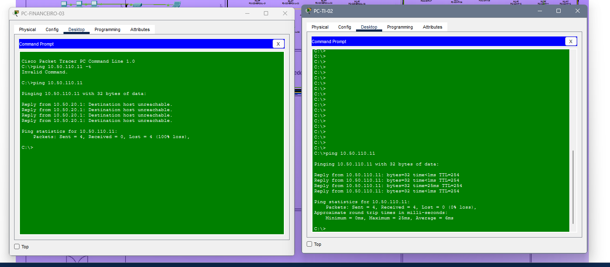

# ACL-GERENCIAMENTO-RESTRITO

## Objetivo

A ACL-GERENCIAMENTO-RESTRITO tem como objetivo proteger a rede de gerenciamento da infraestrutura de TI, correspondente à VLAN 110 (`10.50.110.0/24`), restringindo o acesso aos equipamentos de rede apenas aos dispositivos autorizados.

A política de segurança permite o acesso da VLAN 60 (TI), rede `10.50.60.0/24`, aos recursos de gerenciamento autorizados e bloqueia tentativas de acesso provenientes das VLANs 10 (Administração/Diretoria), 20 (Financeiro), 30 (RH), 40 (Comercial) e 50 (Contabilidade/Fiscal).

Essa medida contribui para reduzir o risco de acessos não autorizados às interfaces administrativas dos switches e de outros equipamentos da infraestrutura.

## Teste de conectividade

A imagem abaixo apresenta o teste de conectividade realizado para verificar o comportamento da rede após a aplicação da ACL.

