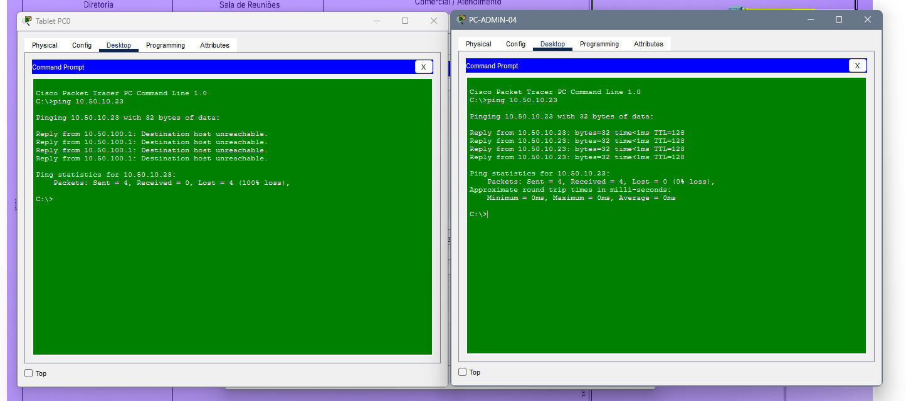

# ACL-VISITANTES-ISOLAMENTO

## Objetivo

A ACL-VISITANTES-ISOLAMENTO tem como objetivo restringir o acesso dos dispositivos conectados à rede Wi-Fi de visitantes, correspondente à VLAN 100 (`10.50.100.0/24`), aos recursos internos do escritório de contabilidade.

A regra busca impedir que os visitantes acessem redes corporativas, como Administração, Financeiro, RH, Comercial, Contabilidade, TI e Gerenciamento, mantendo permitidos os serviços necessários ao funcionamento da rede, conforme a configuração estabelecida.

Essa medida aumenta o isolamento entre os dispositivos externos e os recursos corporativos, reduzindo o risco de acessos indevidos a servidores, computadores, impressoras e equipamentos de rede.

## Teste de conectividade

A imagem abaixo apresenta o teste de ping utilizado para verificar o isolamento da rede de visitantes após a aplicação da ACL.

