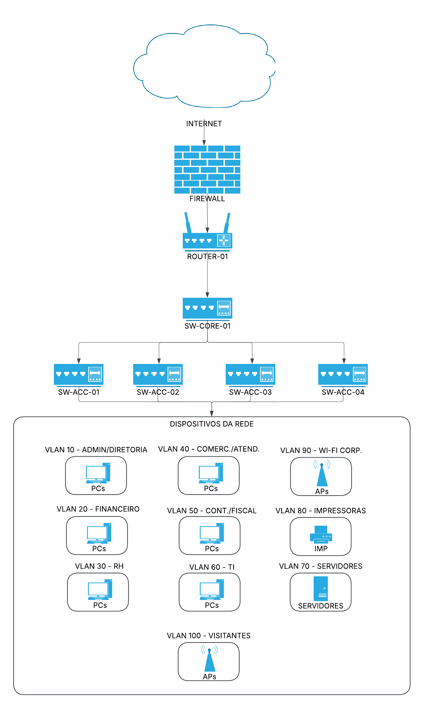
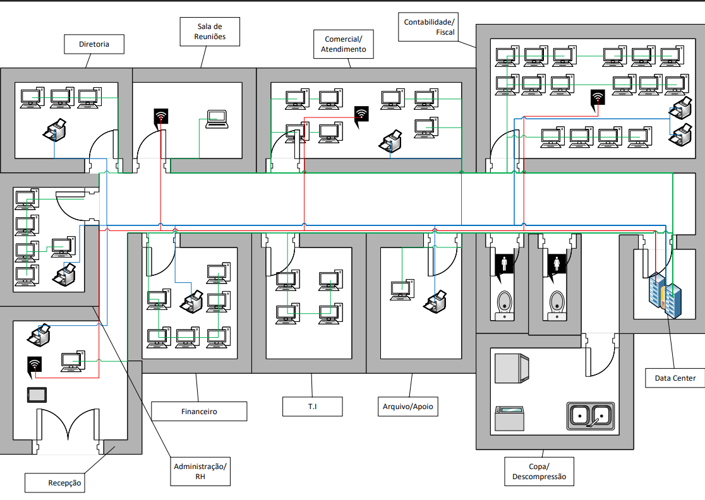
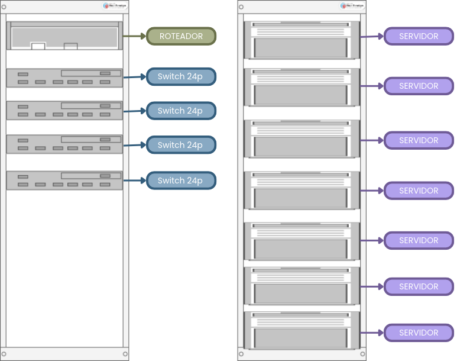

# Documentação do Projeto de Infraestrutura de TI

Esta pasta reúne o relatório acadêmico e os materiais visuais desenvolvidos para o projeto de infraestrutura de TI de um escritório de contabilidade com aproximadamente 50 colaboradores.

Os diagramas e as plantas apresentam a organização física e lógica da infraestrutura proposta, complementando as informações detalhadas no relatório.

## 1. Relatório acadêmico

- [`Projeto-Infraestrutura.pdf`](./Projeto-Infraestrutura.pdf) — versão final do relatório para leitura.
- [`Projeto-Infraestrutura.docx`](./Projeto-Infraestrutura.docx) — versão editável do relatório acadêmico.

O relatório contempla o planejamento da infraestrutura, a topologia da rede, o endereçamento IP e as VLANs, os servidores, a segurança, a conectividade sem fio, os materiais, o orçamento e os resultados dos testes.

---

## 2. Diagrama lógico da rede

O diagrama lógico apresenta os principais dispositivos da infraestrutura e suas conexões, incluindo o acesso à internet, os equipamentos de rede, os servidores, os switches, os pontos de acesso sem fio e os dispositivos finais.

[Visualizar o diagrama em tamanho original](./diagrama-rede.png)

---

## 3. Planta física

A planta física representa a distribuição dos ambientes e setores do escritório, indicando a localização dos computadores, notebooks, impressoras e pontos de acesso sem fio.

[Visualizar a planta física em tamanho original](./planta-fisica.png)

---

## 4. Planta do rack

A planta do rack apresenta a organização física dos equipamentos de infraestrutura, permitindo visualizar a disposição dos componentes instalados nos racks, como switches, patch panels e servidores.

[Visualizar a planta do rack em tamanho original](./planta-rack.png)

---

## 5. Ferramentas utilizadas

As ferramentas utilizadas no desenvolvimento dos diagramas e materiais visuais foram:

- **Lucidchart:** elaboração de diagramas.
- **Microsoft Visio:** criação de diagramas técnicos.
- **Canva:** elaboração e organização de materiais visuais.
- **Visual Paradigm:** elaboração do diagrama do rack.
- **Cisco Packet Tracer:** simulação lógica da infraestrutura de rede.

O arquivo da simulação está disponível na pasta [`Packet-Tracer/`](../Packet-Tracer/).

## 6. Observações

Os diagramas e as plantas complementam o relatório acadêmico e devem ser analisados em conjunto com a simulação da rede.

As imagens representam o planejamento proposto para a infraestrutura. A implementação das funcionalidades e os resultados efetivamente verificados devem ser consultados no relatório e nos registros de testes disponíveis no repositório.

---

**Projeto acadêmico de Infraestrutura de TI — Escritório de Contabilidade.**