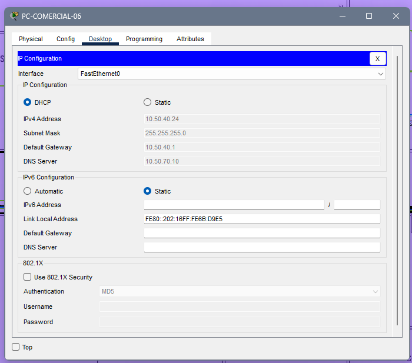
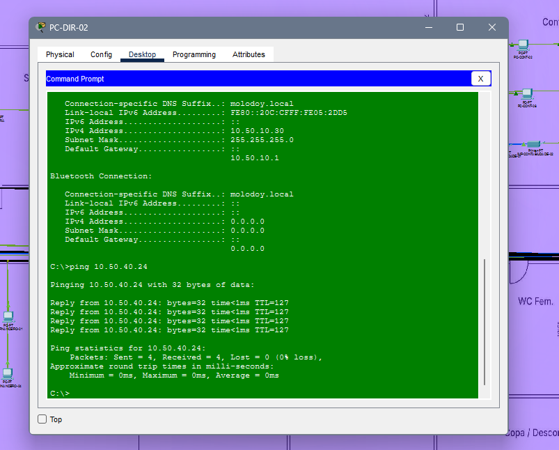
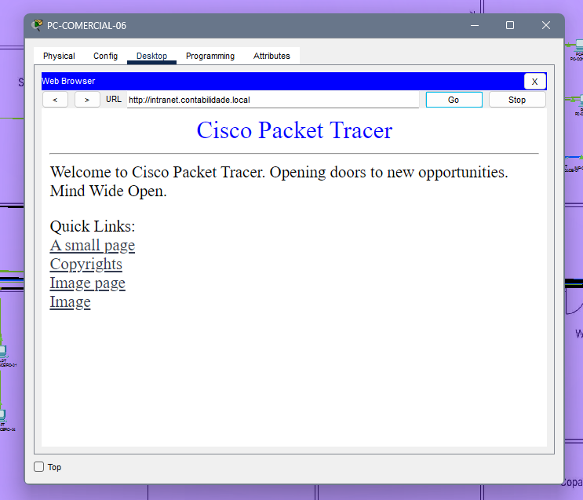
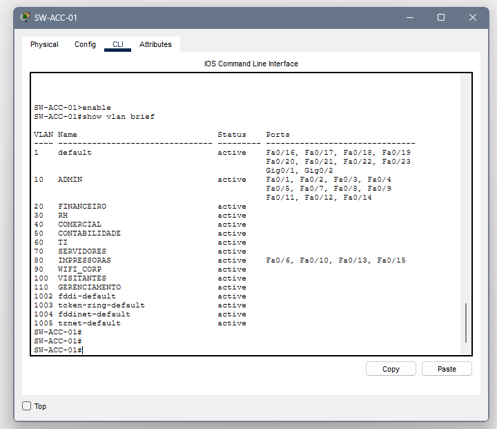
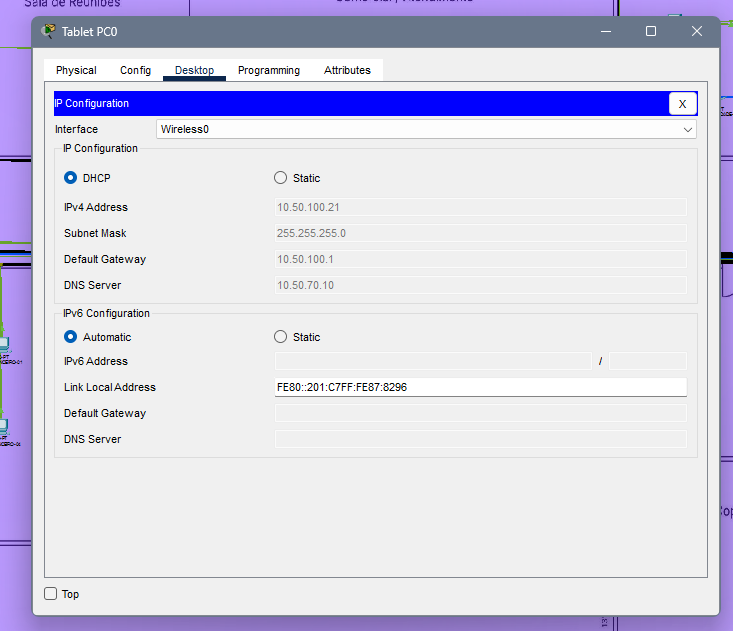
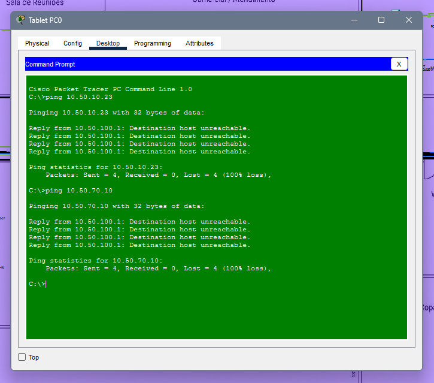

# Testes e Validação da Infraestrutura

Este diretório reúne os procedimentos e as evidências dos testes realizados no Cisco Packet Tracer para validar a infraestrutura de rede do escritório de contabilidade.

Os testes contemplam o endereçamento IP, a distribuição de endereços por DHCP, a comunicação entre VLANs, a resolução DNS, o acesso à intranet, a segmentação da rede e o isolamento dos visitantes.

## 1. Teste de endereçamento IP e DHCP

**Objetivo:** verificar se os dispositivos finais recebem automaticamente os parâmetros de rede correspondentes às suas respectivas VLANs.

Foram previstos pools DHCP para as VLANs 10, 20, 30, 40, 50, 60, 90 e 100. A validação deve confirmar se o endereço IP, a máscara de sub-rede, o gateway e o DNS estão corretos.

## 2. Teste de comunicação entre VLANs

**Objetivo:** verificar a comunicação entre dispositivos pertencentes a redes virtuais distintas, respeitando as regras de roteamento e segurança.

Um exemplo é testar a conectividade de um computador da VLAN 10 com o servidor DNS da VLAN 70, no endereço `10.50.70.10`, desde que o tráfego esteja autorizado pelas políticas de acesso.

## 3. Teste de DNS e acesso à intranet

**Objetivo:** confirmar a resolução do nome `intranet.contabilidade.local` para o endereço `10.50.70.10` e verificar o acesso à página web disponibilizada pelo servidor na simulação.

A validação contempla a resolução de nomes, a conectividade com o servidor e o acesso ao serviço HTTP.

## 4. Teste de segmentação e enlaces trunk

**Objetivo:** verificar a existência das VLANs, a associação das portas aos segmentos corretos e o funcionamento dos enlaces trunk entre os equipamentos de rede.

Os comandos utilizados para a inspeção incluem:

- `show vlan brief`
- `show interfaces trunk`
- `show interfaces fastEthernet 0/11 switchport`

A análise deve considerar as VLANs permitidas nos trunks, o estado das portas e o funcionamento do Spanning Tree.

## 5. Teste de isolamento da rede de visitantes

**Objetivo:** verificar se os dispositivos conectados à VLAN 100 recebem endereços da rede `10.50.100.0/24` e permanecem isolados dos recursos internos não autorizados.

A validação deve contemplar o recebimento de endereço IP, o funcionamento dos serviços necessários e as tentativas de acesso a servidores e à rede de gerenciamento.

### 5.1. Recebimento de endereço IP

### 5.2. Tentativa de acesso aos recursos internos

## 6. Considerações finais

Os testes são utilizados para avaliar o funcionamento dos principais componentes da infraestrutura simulada e identificar eventuais falhas de configuração.

A validação final depende da análise das evidências, da revisão dos enlaces trunk e da confirmação das regras de acesso. Os resultados devem ser registrados conforme o comportamento efetivamente observado no Cisco Packet Tracer.

A simulação contribui para identificar e corrigir problemas antes de uma possível implantação física da infraestrutura.
